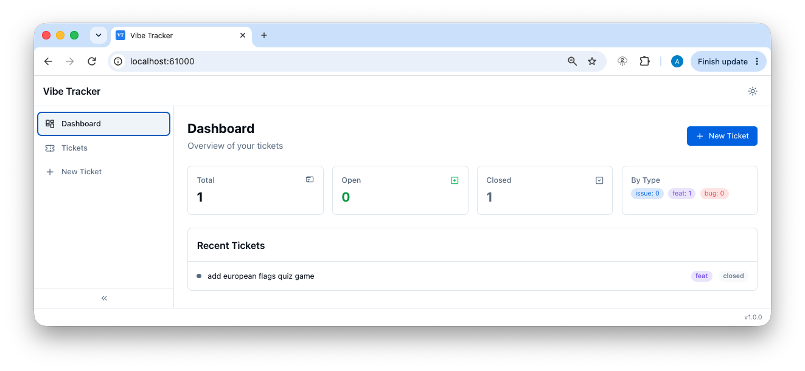
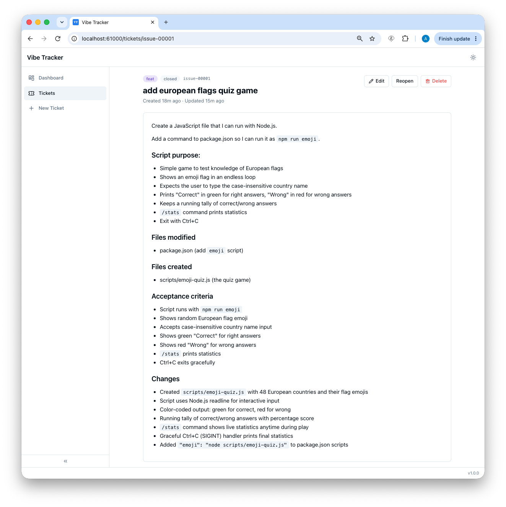

# Vibe Ticket Tracker Example Project

This demo project content was set up with `vibe-ticket-tracker init` package for local ticket tracking.

> **NOTE**: After setup, start the server and keep it running during vibe coding for UI and MCP endpoints.

## Setup & Display Next Steps

```bash
$ mkdir vibe-tracker-example-project
$ cd vibe-tracker-example-project
$ npm init -y
# Add required .gitignore, README.md, etc.                  
$ npm install ../vibe-tracker/vibe-ticket-tracker-1.0.0.tgz
$ npx vibe-ticket-tracker init # Run setup dialog                    

═══ Vibe Ticket Tracker Initialize ═══

❯ What port should the Vibe Ticket Tracker server use? (61000-62000, default: 61000) 
✓ Config written → /Users/mac/workspace-rl/vibe-tracker/vibe-tracker-example-project1/vibe-ticket-tracker.jsonc
✓ Ticket directory → /Users/mac/workspace-rl/vibe-tracker/vibe-tracker-example-project1/.vibe-tracker
❯ Where should the Vibe Ticket Tracker skill file be placed? (default: .opencode/skills/vibe-ticket-tracker.md) 
❯ Generate opencode.jsonc MCP configuration? (y/N) y
✓ MCP config written → /Users/mac/workspace-rl/vibe-tracker/vibe-tracker-example-project1/opencode.jsonc
✓ Skill written → /Users/mac/workspace-rl/vibe-tracker/vibe-tracker-example-project1/.opencode/skills/vibe-ticket-tracker.md
❯ Create VIBE-TICKET-TRACKER-AGENTS.md with Vibe Ticket Tracker workflow? (y/N) y
✓ VIBE-TICKET-TRACKER-AGENTS.md written → /Users/mac/workspace-rl/vibe-tracker/vibe-tracker-example-project1/VIBE-TICKET-TRACKER-AGENTS.md

═══ Setup Complete ═══

Next steps:
  npx vibe-ticket-tracker start    — Start the server
  Open in browser http://localhost:61000
  Agent file → VIBE-TICKET-TRACKER-AGENTS.md
  Skill file → .opencode/skills/vibe-ticket-tracker.md
  MCP config for OpenCode → opencode.jsonc
```

## Workflow

With Vibe Ticket Tracker instructions set up, you will get the following experience during vibe coding:
- new git branch per session;
- new ticket with plan, which will be updated later with implementation details; 
- work completion;

What's left for you:
- review the generated artifacts;
- tell AI coding agent to merge branch back to `main` or keep working on the issue if necessary.

Not happy? Review/Change `VIBE-TICKET-TRACKER-AGENTS.md` and `vibe-ticket-tracker.md` the way you like 😀

> **Vibe Ticket Tracker** is a local ticket tracking system for AI-driven development. It creates tickets before code changes, enforces git branching workflows, and keeps a living record of all work — all via a built-in UI and MCP endpoints.

## Example: European Flags Quiz Game

### Prompt

```text
Create a JavaScript file that I can run with Node.js.
Add command to package.json, so I can run it as `npm run emoji`.

Script purpose:
- It is a simple game to test knowledge of European flags.
- It shows an emoji flag in an endless loop and expects the user to type the case-insensitive country name.
- If the answer is correct, the script prints "Correct" in green; otherwise, it prints "Wrong" in red.
- The script keeps a running tally. 
- If the user enters `/stats` instead of a country name, it prints the statistics of correct and wrong answers.
- Exit the script with Ctrl+C.
```

### Generated artifacts

- new [./scripts/emoji-quiz.js](./scripts/emoji-quiz.js) - implementation according to the prompt.
- new [.vibe-tracker/issue-00001-add-european-flags-quiz-game.md](.vibe-tracker/issue-00001-add-european-flags-quiz-game.md) — ticket created by Vibe Ticket Tracker for the agent's workflow.
- modified [./package.json](./package.json) - added new command line to run script as requested in the prompt.

### Screenshots

#### Dashboard


#### Ticket 

